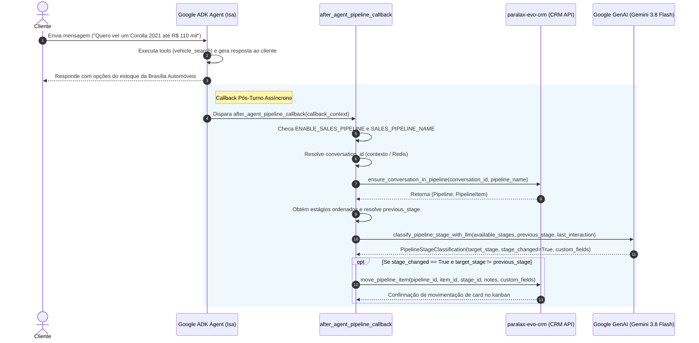

# SPEC-014: Pipeline de Vendas Automatizado nas Conversas do Agente de Veículos

> **Product:** [`customer-support-vehicles`](../products/customer-support-vehicles.yaml) | [`paralax-platform`](../products/paralax-platform.yaml)  
> **Business Capability:** [`customer-relationship-management`](../capabilities/customer-relationship-management/capability.yaml) | [`conversational-ai-agent`](../capabilities/conversational-ai-agent/capability.yaml)  
> **Scope:** Product-Specific (Atendimento e Vendas Concessionária Brasília Automóveis)  
> **Bounded Context:** Atendimento Automotivo, CRM & Funil de Vendas de Veículos (Supporting Subdomain)  
> **Status:** APPROVED  
> **Autor:** Eduardo F. Santos  
> **Data de Criação:** 2026-11-12  
> **Arquitetura 12-Factor:** Zero arquivos de configuração salvos no Git; toda configuração é gerada exclusivamente a partir de variáveis de ambiente  
> **Repositórios Impactados:**  
> - `paralax-ia/customer-support-vehicles` (Onda 1 - Implementação do motor de pipeline, classificação LLM turn-by-turn pós-conversa, callback assíncrono e extração de metadados automotivos)  
> - `paralax-ia/argocd` (Onda 2 - Injeção declarativa das variáveis `ENABLE_SALES_PIPELINE` e `SALES_PIPELINE_NAME` nos manifestos do GKE)  

---

## 1. Contexto e Motivação

No atendimento digital da **Brasília Automóveis**, o agente conversacional de inteligência artificial (`customer-support-vehicles` / Isa) atende 24/7 leads provenientes de anúncios (Meta Ads, Google Ads), redes sociais, plataformas de classificados (Mercado Livre, OLX, Webmotors) e do site institucional (`https://brasiliaautomoveis.com.br`).

Atualmente, quando um lead envia mensagens via WhatsApp ou web, a conversa é registrada no CRM (`evo-ai-crm-community`), porém **não é vinculada automaticamente a nenhum funil de vendas (pipeline/kanban)**. Como consequência:
1. **Falta de Rastreabilidade Comercial:** Vendedores e gerentes comerciais precisam inspecionar manualmente a caixa de entrada para criar cards de oportunidade, gerando atrasos no atendimento e perda de leads qualificados (*lost leads*).
2. **Atualização Manual de Estágios:** Conforme o cliente avança na jornada de compra (buscando veículos, simulando financiamento, oferecendo carro usado na troca, solicitando visita presencial ou pedindo para falar com um vendedor), nenhum card é movimentado no kanban do CRM de forma automática.
3. **Ausência de Metadados Automotivos Estruturados:** Informações comerciais cruciais reveladas pelo cliente (marca e modelo desejados, faixa de orçamento, interesse em troca com dados do usado, necessidade de financiamento) ficam dispersas no histórico de mensagens sem preenchimento dos campos personalizados (*custom fields*) do card.

Para resolver este gargalo com determinismo e escala, esta especificação define a implementação do **Pipeline de Vendas Automatizado nas Conversas do Agente de Veículos**, seguindo rigorosamente os padrões arquiteturais corporativos do ecossistema Paralax IA.

---

## 2. Princípios Arquiteturais e Reutilização de Features do evo-crm

A solução baseia-se diretamente na infraestrutura de CRM já construída no ecossistema, obedecendo aos seguintes pilares:

### 2.0. Reutilização Integral das Features do evo-crm e SDK paralax-evo-crm
Esta especificação **não cria novos endpoints no backend do CRM nem reimplementa chamadas HTTP brutas**, reutilizando integralmente as capacidades já homologadas no `evo-ai-crm-community` e no SDK `paralax-evo-crm` (construídas a partir da SPEC-004):
1. **Endpoint Nativo de Resolução de Conversa (`GET /api/v1/pipelines/by_conversation/:id`):** Consumido através de `crm_api.get_pipelines_by_conversation(conversation_id)`.
2. **Método Orquestrador de Vínculo (`ensure_conversation_in_pipeline`):** Reutiliza o método de alto nível de `paralax.evo.crm.client.CRMAPIClient`, que:
   - Verifica se a conversa já possui card ativo no funil correspondente.
   - Se já possuir, retorna a instância do `Pipeline` e o `PipelineItem` existente com cache em memória.
   - Se for um lead inédito, obtém o pipeline pelo nome (`SALES_PIPELINE_NAME`), identifica a 1ª etapa e cria o card automaticamente via `create_pipeline_item`.
3. **Movimentação e Atualização de Oportunidades (`move_pipeline_item`):** Reutiliza o método do SDK para atualizar a etapa do card (`pipeline_stage_id`), anexar as justificativas textuais em `notes` e persistir os metadados comerciais em `custom_fields`.
4. **Modelos Canônicos de Domínio:** Reutiliza as classes Pydantic `Pipeline`, `PipelineStage` e `PipelineItem` do pacote `paralax.evo.crm.models`.

### 2.1. Configuração 12-Factor Estrita (Zero Configurações no Git)
- É terminantemente proibido versionar arquivos `.env`, `.env.example`, `.yaml` de configuração estáticos no Git.
- O motor de pipeline é controlado pelas variáveis de ambiente:
  - `ENABLE_SALES_PIPELINE`: Booleano (`"true"` ou `"false"`), padrão `False`. Permite desativar ou ativar o mecanismo instantaneamente sem deploy de código (*feature flag*).
  - `SALES_PIPELINE_NAME`: String contendo o nome exato do funil comercial no CRM (ex: `"Vendas de Veículos"` ou `"Brasília Automóveis"`).

### 2.2. Sequência de Estágios Dinâmica do CRM (Sem Hardcode)
- O código do agente **NUNCA** deve conter listas estáticas ou enums com nomes de etapas do funil.
- A partir do nome configurado em `SALES_PIPELINE_NAME`, o agente consulta a API do CRM (`crm_api.ensure_conversation_in_pipeline`), obtendo a instância oficial do `Pipeline` e suas etapas ordenadas pelo atributo `position` (`sorted(pipeline.stages, key=lambda s: s.position)`).
- A primeira etapa da sequência ordenada do CRM é utilizada automaticamente como estágio de entrada caso a conversa ainda não possua card.

### 2.3. Decisão 100% por LLM (Proibição Absoluta de Regex ou Validações Manuais)
- Nenhuma expressão regular (`re.compile`), dicionário de palavras-chave manuais ou árvores de decisão *if/else* rígidas podem ser empregadas para decidir a movimentação de etapa.
- A decisão de **avançar**, **regredir** ou **manter** o cliente na etapa do funil é delegada integralmente a uma chamada estruturada de LLM (Gemini 3.8 Flash via Google GenAI SDK).
- O prompt é gerenciado via Langfuse (`vehicles/pipeline_classifier`) com *fallback* embutido no código.
- O LLM recebe como contexto:
  1. A sequência ordenada completa de estágios disponíveis no CRM.
  2. O estágio anterior em que o cliente se encontrava.
  3. A última interação consolidada da conversa (mensagem do usuário, chamadas de ferramentas de busca/detalhes/anúncios do turno e resposta da Isa).

### 2.4. Governança de Prompts e Ciclo de Vida no Langfuse (Draft -> Produção)
1. **Regra de Prompts de Sistema em Inglês com Restrição PT-BR:**
   - O prompt do classificador (`DEFAULT_STAGE_CLASSIFICATION_PROMPT_TEMPLATE`) deve ser redigido em inglês, contendo a persona, instruções de raciocínio, etapas do CRM e a restrição crítica de idioma: o campo `reason` na resposta estruturada deve ser estritamente em Português (PT-BR).
2. **Ciclo de Vida no Langfuse (Draft -> Produção):**
   - **Fase de Desenvolvimento e Revisão da Spec (Modo Draft):**
     - Enquanto a spec e os Pull Requests estiverem em análise/desenvolvimento (branch de trabalho), o prompt `vehicles/pipeline_classifier` é registrado e consultado no Langfuse com a label `draft`.
     - Isso impede que prompts em teste afetem qualquer comportamento ou tráfego em produção.
   - **Fase Pós-Aprovação e Merge da Spec (Promoção para Produção):**
     - O prompt `vehicles/pipeline_classifier` foi oficialmente registrado e promovido no Langfuse com a label `production` (versão 1).
     - O runtime da aplicação consome por padrão a label `production` (`LANGFUSE_PROMPT_LABEL="production"`).

### 2.5. Suporte a Avanço, Regressão e Manutenção de Estágio
- **Avançar:** Quando a interação demonstra evolução na intenção de compra (ex: de saudação para veículo específico; de veículo específico para proposta de financiamento/troca; de simulação para solicitação de visita/vendedor).
- **Regredir:** Quando o cliente desiste de uma proposta, cancela uma visita agendada, decide pesquisar uma faixa de preço totalmente inferior ou reinicia a conversa pedindo outro modelo.
- **Manter:** Quando a última interação for uma dúvida pontual ou continuação da mesma etapa lógica sem alteração no status de maturidade comercial.

### 2.5. Execução em Callback Pós-Conversa (`after_agent_callback`) com Resiliência
- A lógica é orquestrada através do callback `after_agent_pipeline_callback`, disparado após o encerramento do turno do agente ADK.
- Se o CRM estiver temporariamente inacessível ou o LLM classificador sofrer timeout, a exceção é registrada em log de aviso (*warning*) e suprimida de forma segura, garantindo que a entrega da resposta ao usuário no WhatsApp/web **nunca seja bloqueada ou degradada**.

---

## 3. Escopo e Repositórios Afetados (Ondas Topológicas)

```
┌────────────────────────────────────────────────────────┐
│              ONDA 1 (TASK-1) - AGENTE DE IA            │
│          paralax-ia/customer-support-vehicles          │
│  • Configuração em `vehicles/config.py`:               │
│      ENABLE_SALES_PIPELINE (bool)                      │
│      SALES_PIPELINE_NAME (str)                         │
│  • Módulo de regras `vehicles/pipeline_rules.py`:      │
│      - Prompt template com Langfuse                    │
│      - Modelo Pydantic PipelineStageClassification     │
│      - classify_pipeline_stage_with_llm                │
│      - extract_last_interaction & build_custom_fields  │
│  • Callback `after_agent_pipeline_callback` em         │
│    `vehicles/shared_libraries/callbacks.py`            │
│  • Registro de `after_agent_callback` no root_agent    │
│  • Suíte completa de testes unitários com TDD          │
└───────────────────────────┬────────────────────────────┘
                            │
                            ▼
┌────────────────────────────────────────────────────────┐
│              ONDA 2 (TASK-2) - GITOPS / DEPLOY         │
│                   paralax-ia/argocd                    │
│  • Injeção declarativa em `base/` e `prod/` para o     │
│    deployment `prod-customer-support-v2-vehicles`:     │
│      - ENABLE_SALES_PIPELINE: "true"                   │
│      - SALES_PIPELINE_NAME: "Vendas de Veículos"       │
│  • Testes automatizados de manifestos K8s              │
└────────────────────────────────────────────────────────┘
```

---

## 4. Contratos de Dados e Interfaces

### 4.1. Configuração do Agente (`vehicles/config.py`)

Novos campos adicionados à classe `Config`:

```python
ENABLE_SALES_PIPELINE: bool = Field(
    default=False,
    validation_alias="ENABLE_SALES_PIPELINE",
    description="Feature flag para habilitar a gestão automática de pipeline comercial.",
)
SALES_PIPELINE_NAME: str = Field(
    default="",
    validation_alias="SALES_PIPELINE_NAME",
    description="Nome do funil de vendas alvo cadastrado no CRM.",
)
```

### 4.2. Modelo Estruturado de Classificação do LLM (`vehicles/pipeline_rules.py`)

```python
from pydantic import BaseModel, Field
from typing import Any

class PipelineStageClassification(BaseModel):
    """Resultado estruturado da classificação de estágio do pipeline de veículos pelo LLM."""

    previous_stage_name: str = Field(
        description="Nome do estágio em que o cliente estava antes desta interação."
    )
    target_stage_name: str = Field(
        description=(
            "Nome exato do estágio do pipeline em que o cliente se encontra após a "
            "última interação (escolhido estritamente dentre a sequência de estágios do CRM)."
        )
    )
    stage_changed: bool = Field(
        description="True se houve alteração de estágio (avanço ou regressão) em relação ao anterior."
    )
    reason: str = Field(
        description="Justificativa concisa e comercial para a manutenção, avanço ou regressão."
    )
    custom_fields: dict[str, Any] = Field(
        default_factory=dict,
        description="Metadados comerciais automotivos extraídos da interação.",
    )
```

### 4.3. Metadados Comerciais Automotivos Suportados (`custom_fields`)
- `desired_vehicle_model`: Modelo do veículo de interesse (ex: `"Corolla XEi 2.0"`, `"Civic Touring"`, `"Compass Limited"`).
- `desired_vehicle_make`: Fabricante / Marca (ex: `"Toyota"`, `"Honda"`, `"Jeep"`).
- `budget_max`: Valor monetário máximo ou faixa de investimento (ex: `120000`).
- `has_trade_in`: Booleano indicando se o cliente possui veículo para dar na troca.
- `trade_in_details`: Dados do veículo usado oferecido (ex: `"Gol G6 2015 1.0 flex, 80mil km"`).
- `financing_interest`: Booleano indicando interesse em financiamento ou simulação de parcelas.
- `test_drive_requested`: Booleano indicando se o cliente solicitou visita ou test drive na loja.
- `preferred_contact_time`: Turno preferencial de contato para retorno (ex: `"manhã"`, `"tarde"`).

### 4.4. Prompt Template Padrão do Classificador (`DEFAULT_STAGE_CLASSIFICATION_PROMPT_TEMPLATE`)

```text
You are an expert sales pipeline classifier for the vehicle dealership Brasília Automóveis.
Your task is to analyze the LATEST INTERACTION in the conversation along with the ordered sequence of stages from the CRM and the customer's previous stage, deciding with precision whether the customer should ADVANCE to a subsequent stage, REGRESS to a previous stage, or MAINTAIN/STAY in the current stage.

### Ordered Sequence of Pipeline Stages in CRM:
{{stages_list}}

### Customer's Previous Stage:
{{previous_stage}}

### Latest Conversation Interaction:
{{last_interaction}}

### Decision Guidelines (Advance, Regress, or Maintain):
1. **Advance stage (Avançar estágio):**
   - Advance from the first stage (initial contact / greeting) when the customer specifies interest in a vehicle model, make, price range, year, or sends an external vehicle ad link.
   - Advance to simulation / proposal stage when the customer asks about payment terms, down payment, financing installments, or offers a trade-in vehicle with details.
   - Advance to test drive / store visit or salesperson handoff when the customer requests an in-person visit to the dealership, appointment, or direct phone contact with the sales team.
2. **Regress stage (Regredir estágio):**
   - Regress to an earlier stage if the customer cancels a scheduled visit, gives up on a financing proposal, decides to restart searching for a completely different car, or asks to restart the inquiry.
3. **Maintain stage (Manter estágio):**
   - Stay exactly at `previous_stage` if the latest interaction consists only of routine clarifications, polite acknowledgments, or brief questions within the same stage without altering commercial maturity.
4. **Mandatory Classification Rules:**
   - Choose `target_stage_name` strictly from the stages listed in the CRM sequence.
   - Set `stage_changed` to true whenever `target_stage_name` differs from `previous_stage` (whether advance or regression).
   - Extract in `custom_fields` all identified automotive commercial data (desired_vehicle_model, desired_vehicle_make, budget_max, has_trade_in, trade_in_details, financing_interest, test_drive_requested, preferred_contact_time).
   - **CRITICAL LANGUAGE RESTRICTION:** The `reason` field MUST be written in Portuguese (PT-BR).
```

---

## 5. Fluxo de Execução do Callback (`after_agent_pipeline_callback`)



---

## 6. Critérios de Aceitação (Gherkin)

### Cenário 1: Vínculo automático da conversa na primeira mensagem do cliente
- **Dado** que `ENABLE_SALES_PIPELINE="true"` e `SALES_PIPELINE_NAME="Vendas de Veículos"`
- **E** o lead inicia uma conversa inédita sem card existente no funil
- **Quando** o agente processar a primeira interação do cliente
- **Então** o callback deve invocar `crm_api.ensure_conversation_in_pipeline`
- **E** o card deve ser criado na primeira etapa da sequência do CRM (ex: "Lead Entrou")
- **E** nenhuma falha deve ser propagada para o usuário.

### Cenário 2: Avanço de estágio com extração de modelo e orçamento de interesse
- **Dado** que a conversa já se encontra no estágio inicial ("Lead Entrou")
- **Quando** o cliente envia: *"Estou procurando um Corolla XEi ano 2021 até 115 mil reais"*
- **Então** o LLM classificador deve definir `stage_changed = True`
- **E** `target_stage_name` deve corresponder à etapa seguinte (ex: "Interesse Identificado")
- **E** `custom_fields` deve conter `desired_vehicle_model="Corolla XEi"`, `desired_vehicle_make="Toyota"`, `budget_max=115000`
- **E** o card deve ser movido via `crm_api.move_pipeline_item` com as notas e campos atualizados.

### Cenário 3: Avanço para simulação e avaliação de usado na troca
- **Dado** que o cliente está na etapa "Interesse Identificado"
- **Quando** o cliente envia: *"Tenho um Gol 2017 1.0 flex na troca e quero financiar o restante em 36x"*
- **Então** o LLM classificador deve apontar avanço para a etapa de simulação / proposta
- **E** `custom_fields` deve conter `has_trade_in=True`, `trade_in_details="Gol 2017 1.0 flex"` e `financing_interest=True`.

### Cenário 4: Regressão de estágio por cancelamento ou desistência
- **Dado** que o cliente estava na etapa "Agendamento / Visita"
- **Quando** o cliente envia: *"Preciso cancelar a visita de amanhã. Não vou conseguir ir à loja, prefiro continuar olhando outros modelos mais baratos."*
- **Então** o LLM classificador deve indicar `stage_changed = True` com regressão para etapa anterior (ex: "Interesse Identificado")
- **E** o card deve ser atualizado no CRM refletindo o motivo da regressão nas notas do card.

### Cenário 5: Manutenção de estágio para dúvidas pontuais
- **Dado** que o cliente está em qualquer etapa válida do funil
- **Quando** o cliente pergunta: *"Qual a cor desse Corolla que você me mandou?"*
- **Então** o LLM classificador deve indicar `stage_changed = False`
- **E** `target_stage_name` deve ser idêntico a `previous_stage`
- **E** nenhuma chamada de `move_pipeline_item` deve ser disparada no CRM.

### Cenário 6: Feature flag desabilitada (Opt-out)
- **Dado** que `ENABLE_SALES_PIPELINE="false"` ou não configurada
- **Quando** qualquer interação for concluída pelo agente
- **Então** o callback `after_agent_pipeline_callback` deve retornar imediatamente (no-op)
- **E** nenhuma chamada de rede ao CRM ou ao LLM de classificação deve ocorrer.

### Cenário 7: Resiliência contra indisponibilidade do CRM
- **Dado** que `ENABLE_SALES_PIPELINE="true"`
- **E** a API do CRM lança `CRMAPIError` por timeout de rede ou erro 500
- **Quando** o callback executar
- **Então** a exceção deve ser capturada e logada em nível `WARNING`
- **E** o ciclo de resposta ao usuário final não deve ser afetado.

---

## 7. Plano de Implementação e Verificação

### Tarefas da Onda 1 (`customer-support-vehicles`)
1. **Config:** Adicionar `ENABLE_SALES_PIPELINE` e `SALES_PIPELINE_NAME` em `vehicles/config.py`.
2. **Pipeline Rules:** Criar `vehicles/pipeline_rules.py` com modelos Pydantic, prompts Langfuse/fallback e função `classify_pipeline_stage_with_llm`.
3. **Callbacks:** Implementar `after_agent_pipeline_callback` e resolução de IDs em `vehicles/shared_libraries/callbacks.py`.
4. **Agent Wiring:** Registrar `after_agent_callback=after_agent_pipeline_callback` na instanciação do `Agent` em `vehicles/agent.py`.
5. **Testes Unitários:**
   - `tests/unit/test_config_pipeline.py` (validação de env vars)
   - `tests/unit/test_pipeline_rules.py` (extração de interações, parsing de LLM, custom fields)
   - `tests/unit/test_pipeline_callbacks.py` (fluxos de criação, avanço, regressão, tolerância a falhas)
   - Executar `uv run pytest tests/unit` e `just verify`.

### Tarefas da Onda 2 (`argocd`)
1. **Manifestos:**
   - Adicionar as variáveis `ENABLE_SALES_PIPELINE: "true"` e `SALES_PIPELINE_NAME: "Vendas de Veículos"` em `argocd/base/customer-support-v2-vehicles/deployment.yaml` e `argocd/prod/customer-support-v2-vehicles/patch-env.yaml`.
2. **Testes de Manifestos:**
   - Adicionar asserções em `argocd/tests/test_vehicles_pipeline_manifests.py`.
   - Executar validações com `pytest` e Kustomize.
