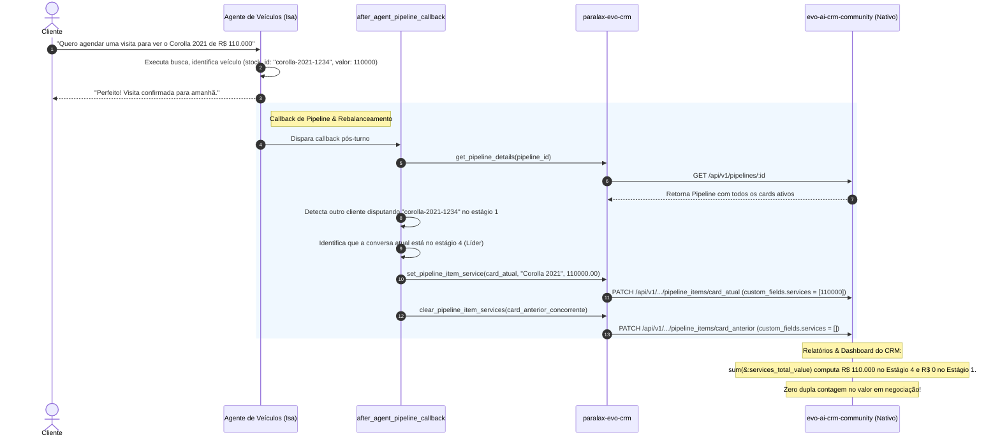

# SPEC-015: Valor em Negociação e Deduplicação de Serviços por Ativo no Funil de Vendas

> **Product:** [`customer-support-vehicles`](../products/customer-support-vehicles.yaml) | [`paralax-platform`](../products/paralax-platform.yaml)  
> **Business Capability:** [`customer-relationship-management`](../capabilities/customer-relationship-management/capability.yaml)  
> **Scope:** Platform & Product-Specific (Comercial, Veículos e Gestão de Serviços no CRM)  
> **Bounded Context:** CRM, Gestão de Serviços & Funil Comercial (Supporting Subdomain)  
> **Status:** DRAFT  
> **Autor:** Eduardo F. Santos  
> **Data de Criação:** 2026-11-14  
> **Arquitetura 12-Factor:** Zero arquivos de configuração no Git; parametrização via variáveis de ambiente centralizadas no ArgoCD.  
> **Diretriz Mandatória de Não-Modificação do CRM:** Zero alterações no código do backend `evo-ai-crm-community`. Todos os relatórios analíticos, dashboards e contadores de Kanban utilizam estritamente o mecanismo nativo de agregação de `services_total_value` em `PipelineItem`.  
> **Repositórios Impactados (Ondas Topológicas):**  
> - `paralax-ia/paralax-evo-crm` (Onda 1 - SDK Python: Métodos genéricos de leitura detalhada de pipeline e manipulação tipada de `services` em `custom_fields`)  
> - `paralax-ia/customer-support-vehicles` (Onda 2 - Agente de IA: Extração de ativo de estoque, detecção de concorrência, prompts e atribuição de valor ao estágio mais avançado)  
> - `paralax-ia/argocd` (Onda 3 - GitOps: Validação declarativa dos manifestos e variáveis de ambiente)

---

## 1. Contexto e Motivação

Com a implementação da progressão automática de pipeline no agente de veículos ([`SPEC-014`](./SPEC-014-pipeline-conversas-veiculos.md)), cada lead atendido pela inteligência artificial recebe um card correspondente no Kanban do CRM (`evo-ai-crm-community`).

Entretanto, o CRM exibe nos seus dashboards gerenciais (`CustomerDashboardService`), relatórios de faturamento potencial e cabeçalhos de etapas o **Valor Total em Negociação**. Atualmente, esses indicadores são calculados nativamente pelo backend através do método `services_total_value` em cada `PipelineItem`, o qual agrega os valores declarados no array `custom_fields['services']`:

```ruby
def services_total_value
  return 0 unless custom_fields&.dig('services').is_a?(Array)
  custom_fields['services'].sum { |service| service['value'].to_f }
end
```

### 1.1. O Desafio de Negócio: Dupla Contagem de Ativos Concorrentes
No varejo de veículos seminovos e usados da **Brasília Automóveis**, cada automóvel é uma unidade única de estoque (*unidade física / chassi / anúncio único*). É comum que **múltiplos clientes se interessem e negociem simultaneamente o mesmo carro** em estágios distintos da jornada de compra:
- Exemplo: Três leads diferentes demonstram interesse pelo mesmo veículo *Toyota Corolla XEi 2021* anunciado por R$ 110.000:
  - Lead A está no estágio 1 ("Lead Entrou / Saudação").
  - Lead B está no estágio 2 ("Interesse Identificado").
  - Lead C está no estágio 4 ("Visita Agendada / Proposta").

Se o agente atribuir ingenuamente o valor de R$ 110.000 ao card de cada um desses três leads, o somatório do CRM reportará R$ 330.000 em negociação, gerando uma distorção irreal de 200% no pipeline financeiro da concessionária.

### 1.2. Decisão de Arquitetura e Engenharia
1. **Preservação Integral do Core do CRM (`evo-ai-crm-community`):**
   * É expressamente proibido alterar o código-fonte do CRM.
   * O ecossistema utilizará os endpoints nativos já existentes (`GET /api/v1/pipelines/:id` e `PATCH /api/v1/pipelines/:pipeline_id/pipeline_items/:id`).
2. **Separação Rígida de Responsabilidades (SoC):**
   * **`paralax-evo-crm` (SDK Python):** Totalmente agnóstico ao domínio de veículos. Fornece ferramentas genéricas para leitura de funis detalhados e gestão declarativa do array `services` no `custom_fields`.
   * **`customer-support-vehicles` (Agente de IA):** Contém 100% da inteligência de domínio automotivo: identificação do veículo de estoque (`vehicle_stock_id`), valor do anúncio (`deal_value`), rastreamento de leads concorrentes pelo mesmo ativo e atribuição do valor de serviço **estritamente ao card posicionado no estágio mais avançado do funil**.
3. **Regra de Priorização por Estágio Mais Avançado:**
   * O valor integral do veículo é alocado ao card que atingiu o estágio com maior `position` no CRM.
   * Os cards concorrentes em estágios anteriores preservam o modelo de interesse em metadados (`desired_vehicle_model`, `vehicle_stock_id`), porém têm seu array `custom_fields['services']` esvaziado (`[]`), garantindo que o CRM compute valor zero para esses cards no somatório analítico.

---

## 2. Princípios de Arquitetura e Contratos

```
┌────────────────────────────────────────────────────────────────────────┐
│                        CRM: evo-ai-crm-community                       │
│  • Endpoint Nativo GET /api/v1/pipelines/:id (inclui stages e items)   │
│  • Endpoint Nativo PATCH /api/v1/pipelines/:p_id/pipeline_items/:id    │
│  • Dashboard e Relatórios somam nativamente: sum(&:services_total_value)│
│  • NENHUMA ALTERAÇÃO DE CÓDIGO NESTE REPOSITÓRIO                       │
└───────────────────────────────────┬────────────────────────────────────┘
                                    │
                                    ▼
┌────────────────────────────────────────────────────────────────────────┐
│                      ONDA 1: paralax-evo-crm (SDK)                     │
│  • Métodos genéricos de leitura e atualização de serviços no card:     │
│    - get_pipeline_details(pipeline_id)                                 │
│    - update_pipeline_item_services(pipeline_id, item_id, services)     │
│    - set_pipeline_item_service(pipeline_id, item_id, name, value)      │
│    - clear_pipeline_item_services(pipeline_id, item_id)                │
│  • Tipagem pura de domínio CRM: PipelineItemService (sem regras de car)│
└───────────────────────────────────┬────────────────────────────────────┘
                                    │
                                    ▼
┌────────────────────────────────────────────────────────────────────────┐
│              ONDA 2: customer-support-vehicles (Agente de IA)          │
│  • Prompts no Langfuse: vehicles/pipeline_classifier & persona         │
│  • Extração de vehicle_stock_id e deal_value no classificador LLM      │
│  • Callback pós-turno de concorrência automotiva:                      │
│    - Mapeia cards ativos no pipeline com o mesmo vehicle_stock_id      │
│    - Ordena por pipeline_stage.position (descendente)                  │
│    - Aloca serviço de R$ 110.000 no card do estágio mais avançado      │
│    - Remove serviços dos cards concorrentes em estágios inferiores     │
└────────────────────────────────────────────────────────────────────────┘
```

---

## 3. Especificação Detalhada por Repositório

### 3.1. Onda 1: `paralax-ia/paralax-evo-crm` (SDK de CRM)

O SDK provê utilitários tipados e assíncronos para inspeção de itens e manipulação de serviços de forma neutra.

#### 3.1.1. Modelos Tipados (`paralax.evo.crm.models`)
```python
from pydantic import BaseModel, Field

class PipelineItemService(BaseModel):
    """Representação estruturada de um serviço ou item de valor alocado a um card do pipeline."""

    name: str = Field(description="Descrição ou título do serviço/item no card.")
    value: str = Field(description="Valor monetário formatado (ex: '110000.00').")
    service_definition_id: str | None = Field(
        default=None,
        description="ID opcional do serviço de catálogo vinculado no CRM.",
    )
```

#### 3.1.2. Novos Métodos no Cliente (`paralax.evo.crm.client.CRMAPIClient`)
1. **`get_pipeline_details(pipeline_id: str | int) -> Pipeline`**:
   * Executa requisição HTTP `GET {crm_url}/api/v1/pipelines/{pipeline_id}`.
   * O endpoint `show` do CRM retorna o payload completo com `stages` e todos os `items` vinculados aos estágios.
   * Retorna a instância completa de `Pipeline` populada com `all_items`.
2. **`update_pipeline_item_services(pipeline_id: str | int, item_id: str | int, services: list[PipelineItemService | dict[str, Any]], custom_fields_extra: dict[str, Any] | None = None) -> PipelineItem`**:
   * Converte a lista para o formato de dicionário esperado pelo CRM:
     `{"services": [{"name": s.name, "value": str(s.value)} for s in services]}`.
   * Mescla com `custom_fields_extra` (se fornecido).
   * Dispara `PATCH {crm_url}/api/v1/pipelines/{pipeline_id}/pipeline_items/{item_id}` com `{"custom_fields": merged_custom_fields}`.
3. **`set_pipeline_item_service(pipeline_id: str | int, item_id: str | int, name: str, value: float | str, custom_fields_extra: dict[str, Any] | None = None) -> PipelineItem`**:
   * Atalho de conveniência para atribuir um serviço único ao card.
4. **`clear_pipeline_item_services(pipeline_id: str | int, item_id: str | int, custom_fields_extra: dict[str, Any] | None = None) -> PipelineItem`**:
   * Atribui `custom_fields["services"] = []`, zerando o `services_total_value` no CRM sem apagar outras chaves de metadados.

---

### 3.2. Onda 2: `paralax-ia/customer-support-vehicles` (Agente de IA)

Toda a regra de negócio automotiva, estoque e deduplicação reside no agente.

#### 3.2.1. Metadados e Chaves Estruturadas (`vehicles/pipeline_rules.py`)
Novos campos adicionados à tupla `CUSTOM_FIELD_KEYS` e ao classificador:
- `vehicle_stock_id`: Identificador canônico do veículo no estoque da concessionária (ex: slug do anúncio extraído do site `brasiliaautomoveis.com.br` como `"corolla-xei-20-flex-2021"` ou código interno retornado pela ferramenta `vehicle_search`).
- `deal_value`: Valor monetário numérico do veículo selecionado/negociado (ex: `110000.0`).

```python
CUSTOM_FIELD_KEYS = (
    "desired_vehicle_model",
    "desired_vehicle_make",
    "budget_max",
    "has_trade_in",
    "trade_in_details",
    "financing_interest",
    "test_drive_requested",
    "preferred_contact_time",
    "vehicle_stock_id",
    "deal_value",
)
```

#### 3.2.2. Lógica de Deduplicação de Veículo Concorrente
No callback pós-turno (`after_agent_pipeline_callback` em `vehicles/shared_libraries/callbacks.py`):
1. **Identificação da Intenção de Veículo:**
   * Se o turno atual ou o histórico do card identificar um `vehicle_stock_id` e um `deal_value`:
2. **Consulta dos Cards Concorrentes no Funil:**
   * O agente consulta `crm_api.get_pipeline_details(pipeline.id)`.
   * Filtra todos os itens ativos (`completed_at is None`) pertencentes àquele funil cujo `custom_fields.get("vehicle_stock_id") == current_stock_id`.
3. **Ranqueamento por Estágio Comercial:**
   * Mapeia cada card ativo para a posição de sua etapa (`stage.position`).
   * **Card Líder:** O card ativo associado à etapa de maior `position` (mais próxima do fechamento/visita).
   * Em caso de empate no mesmo estágio, o card com `updated_at` mais recente assume a liderança.
4. **Aplicação Determinística dos Serviços:**
   * **No Card Líder:** 
     O agente invoca `crm_api.set_pipeline_item_service(pipeline_id, leader_item.id, name=f"{vehicle_make} {vehicle_model} ({vehicle_stock_id})", value=deal_value)`.
     O card passa a computar `services_total_value == deal_value` no CRM.
   * **Nos Demais Cards Concorrentes (Estágios Inferiores):**
     O agente invoca `crm_api.clear_pipeline_item_services(pipeline_id, competing_item.id)`.
     O card mantém as chaves `vehicle_stock_id`, `desired_vehicle_model` e `contending_status="competing_in_lower_stage"`, porém tem `services = []`, resultando em `services_total_value == 0.0`.
5. **Rebalanceamento por Regressão ou Fechamento:**
   * Caso o Card Líder sofra regressão para uma etapa inferior, seja cancelado ou arquivado, o callback reavalia os concorrentes ativos restantes do mesmo `vehicle_stock_id`, promovendo o novo líder imediatamente.

---

### 3.3. Onda 3: `paralax-ia/argocd` (GitOps)

- Validação declarativa de conformidade de variáveis de ambiente.
- Testes automatizados de integridade dos manifestos com Kustomize e Pytest.

---

## 4. Governança e Alterações de Prompts

A captura de `vehicle_stock_id` e `deal_value` depende de sintonia fina em dois prompts do ecossistema: o **classificador pós-turno de pipeline** (que extrai os metadados) e a **instrução de persona do agente** (que contextualiza a interação).

### 4.1. Prompt do Classificador (`vehicles/pipeline_classifier`)

* **Arquivo de Origem:** `vehicles/pipeline_rules.py` (`DEFAULT_STAGE_CLASSIFICATION_PROMPT_TEMPLATE`)
* **Langfuse Prompt Name:** `vehicles/pipeline_classifier`
* **Label durante Implementação:** `draft` (promovido para `production` após aprovação do PR da spec)
* **Idioma da Instrução:** Inglês (com restrição mandatória de que o campo `reason` seja em PT-BR)

#### Alterações no Template do Prompt:
Adiciona-se a diretriz explícita de extração para diferenciar **busca aberta/orçamento genérico** de **negociação de ativo específico em estoque**:

```text
### Extraction Guidelines for Vehicle Assets & Negotiation Values (Mandatory):
1. **Generic Inquiries / Broad Budgets:**
   - If the customer is only asking about a price range or category without a specific car selected (e.g., "procuro carros até 100 mil" or "tem sedãs automáticos?"):
     - Extract `budget_max` with the numeric limit (e.g., 100000).
     - Set `vehicle_stock_id = null` and `deal_value = null`.
2. **Specific Stock Vehicle in Negotiation:**
   - If the customer focuses on, simulates, or negotiates a SPECIFIC vehicle presented by the assistant or from an ad URL/link (e.g., "gostei do Corolla 2021 de 110 mil", "vamos agendar visita para ver o Civic 2020", or user sent an ad link):
     - Extract `vehicle_stock_id`: the canonical ad slug, URL segment, or unique stock ID of that vehicle (e.g., "corolla-xei-20-flex-2021-brasilia-df").
     - Extract `deal_value`: the exact numeric price of that vehicle (e.g., 110000.0).
     - Extract `desired_vehicle_model` and `desired_vehicle_make`.
```

#### Diff no Prompt Template (`DEFAULT_STAGE_CLASSIFICATION_PROMPT_TEMPLATE`):
```diff
 ### Mandatory Classification Rules:
    - Choose `target_stage_name` strictly from the stages listed in the CRM sequence.
    - Set `stage_changed` to true whenever `target_stage_name` differs from `previous_stage` (whether advance or regression).
-   - Extract in `custom_fields` all identified automotive commercial data (desired_vehicle_model, desired_vehicle_make, budget_max, has_trade_in, trade_in_details, financing_interest, test_drive_requested, preferred_contact_time).
+   - Extract in `custom_fields` all identified automotive commercial data:
+     * desired_vehicle_model, desired_vehicle_make
+     * budget_max (when lead states a general price ceiling)
+     * vehicle_stock_id (canonical ad slug or stock ID when a specific car is identified)
+     * deal_value (float price of the specific vehicle in negotiation)
+     * has_trade_in, trade_in_details, financing_interest, test_drive_requested, preferred_contact_time
    - **CRITICAL LANGUAGE RESTRICTION:** The `reason` field MUST be written in Portuguese (PT-BR).
```

---

### 4.2. Prompt de Persona da Assistente (`vehicles/system_instruction` / Isa)

* **Arquivo de Origem:** `vehicles/prompts.py` (`INSTRUCTION`)
* **Langfuse Prompt Name:** `vehicles/system_instruction`
* **Label durante Implementação:** `draft`

#### Reforço Instrucional na Persona:
O agente Isa já replica integralmente as saídas das ferramentas `get_vehicle_details` (que contêm o link `🔗 *Veja o anúncio:* https://brasiliaautomoveis.com.br/veiculo/...` e o valor).  
Adiciona-se uma diretriz suplementar na seção `<response_style_and_formatting>` para assegurar consistência no avanço de propostas e agendamentos:

```markdown
<deal_and_scheduling_coherence>
Ao avançar para simulação de financiamento, negociação de entrada, avaliação de troca ou agendamento de visita presencial:
1. Sempre confirme explicitamente o modelo exato e o valor anunciado do veículo em negociação (ex: "Confirmando o agendamento para o Toyota Corolla XEi 2021 no valor de R$ 110.000...").
2. Isso garante rastreabilidade comercial imediata e associação inequívoca do ativo no histórico de atendimento.
</deal_and_scheduling_coherence>
```

---

### 4.3. Ciclo de Vida e Promoção no Langfuse

1. **Fase de Desenvolvimento (Modo `draft`):**
   * Os prompts `vehicles/pipeline_classifier` e `vehicles/system_instruction` são versionados no Langfuse com a label `draft`.
   * Os testes unitários e de integração do repositório `customer-support-vehicles` validam a nova versão contra a label `draft` usando fixtures controladas.
2. **Fase de Homologação e Merge (Promoção para `production`):**
   * Ao aprovar e mergear a spec e o PR da Onda 2, os prompts são promovidos para a label `production` no Langfuse.
   * A aplicação em execução no GKE passa a carregar deterministicamente a versão produtiva sem necessidade de novo build.

---

## 5. Fluxo de Execução Sequencial



---

## 6. Critérios de Aceitação (Gherkin)

### Cenário 1: Atribuição de valor em negociação para lead único
- **Dado** que o lead selecionou um veículo de estoque com valor de R$ 95.000
- **E** nenhum outro card ativo no funil disputa este mesmo veículo
- **Quando** a conversa for processada e o card for movimentado de etapa
- **Então** o LLM classificador deve extrair `vehicle_stock_id` e `deal_value=95000.0`
- **E** o SDK deve registrar em `custom_fields['services']` o serviço correspondente no valor de R$ 95.000
- **E** o CRM deve computar `services_total_value = 95000.0` para este card.

### Cenário 2: Deduplicação de valor quando múltiplos leads disputam o mesmo veículo
- **Dado** que o Lead A está no estágio "Interesse Identificado" (posição 2) com o veículo `"civic-2020-5678"` de R$ 125.000
- **E** o Lead A atualmente possui o serviço de R$ 125.000 registrado em seu card
- **Quando** o Lead B demonstrar interesse pelo mesmo veículo `"civic-2020-5678"` e avançar para "Simulação de Financiamento" (posição 3)
- **Então** o Lead B deve se tornar o Card Líder para esse ativo
- **E** o card do Lead B deve ter `custom_fields['services']` atualizado com o valor de R$ 125.000
- **E** o card do Lead A deve ter `custom_fields['services']` esvaziado (`[]`), zerando seu valor no CRM
- **E** o somatório total do pipeline para esse veículo nos relatórios do CRM deve permanecer exatamente R$ 125.000.

### Cenário 3: Reversão e assunção de valor por lead concorrente após regressão
- **Dado** que o Lead B (Card Líder na posição 3 com R$ 125.000) decide desistir da compra e regride para "Dúvidas Gerais" (posição 1)
- **Quando** o callback pós-turno for executado
- **Então** o Lead A (permanecendo na posição 2) deve ser promovido a novo Card Líder do veículo `"civic-2020-5678"`
- **E** o card do Lead A deve ter seu serviço de R$ 125.000 reativado em `custom_fields['services']`
- **E** o card do Lead B deve ter seus serviços esvaziados.

### Cenário 4: Não-interferência em leads com veículos distintos
- **Dado** que existem três leads ativos negociando veículos distintos (Veículo X de R$ 80.000, Veículo Y de R$ 120.000 e Veículo Z de R$ 150.000)
- **Quando** os cards forem atualizados
- **Então** cada card deve manter seu respectivo serviço de valor integral ativo
- **E** o somatório no dashboard do CRM deve totalizar R$ 350.000 sem deduplicações indevidas.

### Cenário 5: Independência de Domínio no SDK `paralax-evo-crm`
- **Dado** o código-fonte do repositório `paralax-evo-crm`
- **Quando** inspecionado por ferramentas de lint e checagem estática
- **Então** nenhuma classe, método ou comentário deve fazer menção a "veículo", "carro", "concessionária", "placa" ou "chassi"
- **E** todos os métodos adicionados devem operar puramente sobre entidades canônicas do CRM (`Pipeline`, `PipelineItem`, `PipelineItemService`).

---

## 7. Plano de Implementação e Verificação

### Onda 1: `paralax-ia/paralax-evo-crm`
1. Modelagem Pydantic `PipelineItemService` em `paralax/evo/crm/models.py`.
2. Implementação dos métodos no `CRMAPIClient`:
   - `get_pipeline_details(pipeline_id)`
   - `update_pipeline_item_services(pipeline_id, item_id, services, custom_fields_extra)`
   - `set_pipeline_item_service(pipeline_id, item_id, name, value, custom_fields_extra)`
   - `clear_pipeline_item_services(pipeline_id, item_id, custom_fields_extra)`
3. Suíte de testes unitários com TDD em `tests/unit/test_pipeline_services.py`.
4. Validação completa via `just verify`.

### Onda 2: `paralax-ia/customer-support-vehicles`
1. Versionamento do prompt `vehicles/pipeline_classifier` no Langfuse (label `draft`) com extração de `vehicle_stock_id` e `deal_value`.
2. Atualização de `vehicles/prompts.py` (Isa) para reforço instrucional de valor e confirmação de estoque.
3. Adição de `vehicle_stock_id` e `deal_value` na tupla `CUSTOM_FIELD_KEYS` e em `pipeline_rules.py`.
4. Implementação da lógica de resolução de líder de ativo e rebalanceamento em `vehicles/pipeline_rules.py` e `vehicles/shared_libraries/callbacks.py`.
5. Testes unitários com TDD simulando múltiplos leads concorrentes, promoção e regressão de líder em `tests/unit/test_competing_vehicle_pipeline.py`.
6. Validação completa via `just verify`.

### Onda 3: `paralax-ia/argocd`
1. Validação de manifestos e checagens K8s via `just verify`.
