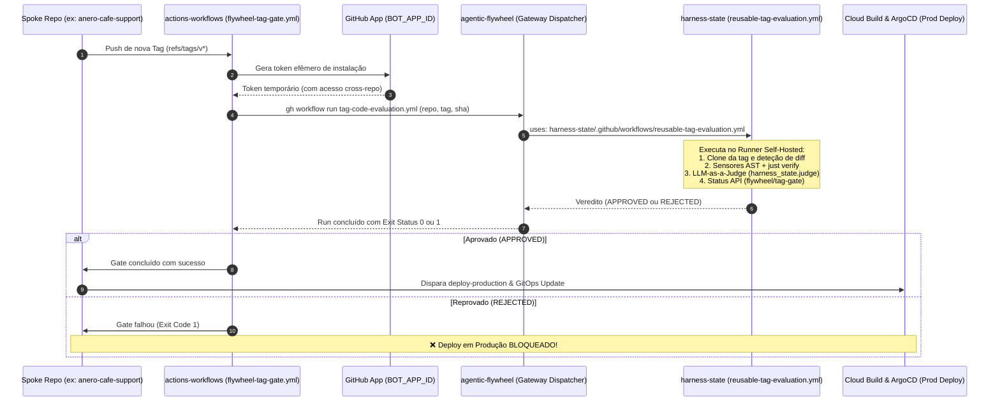

# SPEC-017: Bloqueio de Deploy em Produção por Reprovação do Flywheel em Novas Tags e Otimização de CI/CD

> **Product:** [`paralax-platform`](../products/paralax-platform.yaml)  
> **Business Capability:** [`ci-cd-orchestration`](../capabilities/ci-cd-orchestration/capability.yaml)  
> **Scope:** Platform (Transversal a todos os repositórios e serviços do ecossistema Paralax IA)  
> **Bounded Context:** Orquestração de CI/CD, Gate de Release Federado e Política de Deploy em Produção sob Governança do Flywheel e Workflows Reutilizáveis do Harness-State  
> **Status:** DRAFT · **Version:** `1.1.0`  
> **Alinhamento Arquitetural:** Em total conformidade com a [SPEC-012 (harness-spec-hub)](../../harness-spec-hub/specs/SPEC-012-cross-repo-tag-evaluation-gate-and-harness-lifecycle.md)  
> **Autor:** Antigravity / Eduardo F. Santos  
> **Data de Atualização:** 2026-11-21  

---

## 1. Contexto e Motivação

No ecossistema corporativo da **Paralax IA**, o código é continuamente gerado, refatorado e mantido por agentes de IA orientados pelo arcabouço federado da Plataforma SDD. Em estrita consonância com a **SPEC-012 (v1.1.0)**, a governança e a separação de responsabilidades entre as camadas do ecossistema são delineadas da seguinte forma:

1. **`harness-state` (`core`, open-source AGPL-3.0):** Repositório central detentor da inteligência canônica, da CLI `harness`, dos modelos, dos sensores determinísticos, do motor de julgamento (`harness_state.judge`) e dos **workflows reutilizáveis canônicos (`.github/workflows/reusable-tag-evaluation.yml` e `reusable-test.yml`)**.
2. **`agentic-flywheel` (`execution-engine`, privado):** Nó executor de infraestrutura em nuvem, responsável por disponibilizar runners dedicados *self-hosted* (com acesso a GPU/Ollama local) e pelo gateway federado de despacho remoto acionado via GitHub App (`BOT_APP_ID`). Não bifurca nem duplica lógica de avaliação; consome diretamente os workflows reutilizáveis do `harness-state`.
3. **`paralax-ia/*` (Spokes e Pipelines de Negócio):** Repositórios consumidores que utilizam `actions-workflows` para compilação, publicação e implantação no Google Artifact Registry, DockerHub e clusters GKE via ArgoCD.

### Fricções Operacionais Resolvidas por esta Especificação:

1. **Deploy Incondicional em Novas Tags:** Sempre que uma tag `v*` era gerada nos spokes (seja por automações de release ou humanos), os workflows acionavam de imediato a compilação de imagens no Cloud Build e a sincronização do ArgoCD em produção. releases com violações de contrato, falhas de sensores ou desvios arquiteturais entravam em produção sem qualquer validação prévia do Juiz de Código.
2. **Descontinuação Definitiva de Tokens Estáticos:** O token pessoal `FLYWHEEL_DISPATCH_TOKEN` foi revogado e descontinuado. Toda a interoperabilidade federada entre os repositórios da organização `paralax-ia` e o hub `eduardosan/agentic-flywheel` deve operar estritamente através do GitHub App canônico (`BOT_APP_ID` e `BOT_PRIVATE_KEY`), gerando tokens de instalação efêmeros via `actions/create-github-app-token@v1`.
3. **Desperdício de Recursos e Retestes no Merge da `main`:** Os spokes frequentemente executavam as mesmas suítes de testes unitários pesadas no evento `pull_request` e, repetidamente, no evento `push: branches: [main]`. Como a branch `main` possui proteção estrita exigindo PR prévio aprovado (*Required Status Checks*), a reexecução pós-merge gerava filas e atrasos desnecessários.
4. **Padronização de Comandos da CLI `harness`:** Consolidação dos comandos oficiais da CLI `harness` (100% baseados no `harness-state`) para instalar/atualizar templates de CI/sensores nos spokes e manter a sincronização com o `paralax-spec-hub`.

---

## 2. Escopo e Repositórios Afetados

A implementação organiza-se em **duas ondas topológicas estritas**:

### Onda 1 (Infraestrutura Central de CI/CD e Governança)
- [ ] **Sub-tarefa 1 (`paralax-ia/paralax-spec-hub`):** [Onda 1] [hub] Registro da SPEC-017 no catálogo e alinhamento com a capability `ci-cd-orchestration`.
- [ ] **Sub-tarefa 2 (`paralax-ia/actions-workflows`):** [Onda 1] [ci-cd]
  - Criação do workflow reutilizável `flywheel-tag-gate.yml` utilizando `BOT_APP_ID` para acionar o gateway do `agentic-flywheel` (que executa o `reusable-tag-evaluation.yml` do `harness-state`).
  - Injeção do pré-requisito `needs: [flywheel-gate]` nos workflows `agent-deploy.yml` e `python-package-pipeline.yml`.
  - Adoção da verificação de checks prévios na suíte de testes compartilhada para eliminar retestes redundantes.

### Onda 2 (Consumidores, Agentes, SDKs e Microsserviços)
- [ ] **Sub-tarefa 3 (`paralax-ia/customer-support-vehicles`, `anero-cafe-support`, `duo-dermato-support`, `google-calendar-agent`, `paralax-support`):** [Onda 2] [agents] Atualização de `deploy.yml` para encadear `needs: flywheel-gate` condicionado exclusivamente a tags, propagando `secrets: inherit`.
- [ ] **Sub-tarefa 4 (`paralax-ia/paralax-agents-common`, `paralax-evo-crm`):** [Onda 2] [sdks] Inclusão do gate antes da publicação de releases de pacotes no Artifact Registry e GitHub Releases.
- [ ] **Sub-tarefa 5 (`paralax-ia/evo-bot-runtime`, `evo-ai-crm-community`, `evo-ai-frontend-community`):** [Onda 2] [services] Otimização dos triggers de `ci.yml` e `docker-publish.yml` para eliminar retestes redundantes no merge da `main`.

---

## 3. Contratos de Interface e Arquitetura



---

### 3.1. Workflow Reutilizável `flywheel-tag-gate.yml` (`actions-workflows`)

Workflow reutilizável centralizado em `actions-workflows/.github/workflows/flywheel-tag-gate.yml` que atua como orquestrador cliente do spoke:

```yaml
# actions-workflows/.github/workflows/flywheel-tag-gate.yml
name: Flywheel Tag Gate

on:
  workflow_call:
    inputs:
      tag:
        description: "Tag da release candidata a ser avaliada (ex: v0.3.2)"
        required: true
        type: string
      target_repo:
        description: "Repositório do spoke (padrão: github.repository)"
        required: false
        type: string
        default: ""
    secrets:
      BOT_APP_ID:
        description: "ID do GitHub App corporativo"
        required: true
      BOT_PRIVATE_KEY:
        description: "Chave privada do GitHub App corporativo"
        required: true

jobs:
  evaluate-tag:
    name: "Validar Release no Flywheel"
    runs-on: ubuntu-latest
    steps:
      - name: Gerar Token de GitHub App para o Flywheel Gateway
        id: app-token
        uses: actions/create-github-app-token@v1
        with:
          app-id: ${{ secrets.BOT_APP_ID }}
          private-key: ${{ secrets.BOT_PRIVATE_KEY }}
          owner: eduardosan
          repositories: agentic-flywheel

      - name: Acionar Avaliação no Flywheel e Aguardar Veredito Canônico
        env:
          GH_TOKEN: ${{ steps.app-token.outputs.token }}
          REPO: ${{ inputs.target_repo || github.repository }}
          TAG: ${{ inputs.tag }}
          COMMIT_SHA: ${{ github.sha }}
        run: |
          set -eo pipefail
          echo "🚀 Solicitando avaliação da tag ${TAG} (${COMMIT_SHA}) para ${REPO} no Flywheel Gateway..."
          
          # Aciona o gateway no repositório agentic-flywheel
          gh workflow run tag-code-evaluation.yml \
            -R eduardosan/agentic-flywheel \
            -f target_repo="${REPO}" \
            -f tag="${TAG}" \
            -f commit_sha="${COMMIT_SHA}"

          # Aguarda o registro e obtenção do Run ID
          sleep 8
          RUN_ID=$(gh run list -R eduardosan/agentic-flywheel \
            --workflow=tag-code-evaluation.yml \
            --json databaseId -q '.[0].databaseId')

          echo "Acompanhando execução do Flywheel Gate (Run ID: ${RUN_ID})..."
          gh run watch "${RUN_ID}" -R eduardosan/agentic-flywheel --exit-status
```

---

### 3.2. Bloqueio Seletivo: Condição Estrita para Novas Tags

Conforme estabelecido pela governança, o bloqueio aplica-se **exclusivamente a tags de release**. Pull Requests e deploys manuais de staging/main não passam pelo gate de tag:

Nos orquestradores dos agentes (`.github/workflows/deploy.yml`):

```yaml
jobs:
  # Executa testes rápidos apenas em PR
  test-pr:
    if: github.event_name == 'pull_request'
    uses: paralax-ia/actions-workflows/.github/workflows/agent-deploy.yml@main
    secrets: inherit
    with:
      agent_version: 'pr-${{ github.event.pull_request.number }}'
      deploy_target: 'none'

  # Gate do Flywheel: Ativado SOMENTE no caso de novas tags
  flywheel-gate:
    name: Flywheel Quality Gate
    if: startsWith(github.ref, 'refs/tags/')
    uses: paralax-ia/actions-workflows/.github/workflows/flywheel-tag-gate.yml@main
    secrets: inherit
    with:
      tag: ${{ github.ref_name }}

  # Deploy em Produção: Condicionado à aprovação do Flywheel
  deploy-production:
    name: Deploy to Production from Tag
    needs: [ flywheel-gate ]  # 👈 SÓ EXECUTA SE O FLYWHEEL APROVAR
    if: startsWith(github.ref, 'refs/tags/')
    uses: paralax-ia/actions-workflows/.github/workflows/agent-deploy.yml@main
    secrets: inherit
    with:
      agent_version: ${{ github.ref_name }}
      deploy_target: 'production'
      agent_service_name: 'prod-anero-cafe-support'
```

---

### 3.3. Eliminação de Testes Redundantes no Merge da `main`

Em total harmonia com o item 3.3 da **SPEC-012**:

1. **Inspeção de Check Runs Prévios (Padrão API):**  
   Nos workflows onde a execução na `main` for mantida, insere-se a verificação prévia no GitHub antes de rodar os testes:
   ```bash
   # Verifica se o SHA já possui check run de teste concluído com sucesso no PR
   PREV_CHECK=$(gh api "repos/${GITHUB_REPOSITORY}/commits/${GITHUB_SHA}/check-runs" \
     --jq '.check_runs[] | select(.name == "Test" and .conclusion == "success") | .id' 2>/dev/null || true)

   if [ -n "$PREV_CHECK" ]; then
     echo "✅ Commit ${GITHUB_SHA} já validado e aprovado com sucesso no PR (Check Run ID: ${PREV_CHECK}). Pulando reteste redundante na main."
     exit 0
   fi
   ```
2. **Separação de Triggers em Microsserviços (`evo-bot-runtime`, `evo-ai-frontend-community`):**  
   No arquivo `ci.yml`, a suíte unitária passa a escutar exclusivamente `pull_request`. No `docker-publish.yml`, a compilação da imagem Docker utiliza o cache dos artefatos validados no PR, sem reexecutar suítes de teste durante o push na `main`.

---

### 3.4. Comandos Canônicos para Atualização de Repositórios e Spec Hub

Toda a infraestrutura de linha de comando é provida pelo pacote canônico `harness-state` e executada através do binário oficial `harness`:

#### A. Atualizar o Harness de um Repositório Spoke:
1. **Instalar / Atualizar templates de sensores, workflows e justfile no Spoke:**
   ```bash
   harness install --path /home/eduardo/srv/paralax-ia/<nome-do-spoke>
   ```
   *Efeito:* Sincroniza `.harness/sensors/`, `.harness/config.yaml` e atualiza a interface canônica `justfile` (`just check`, `just lint`, `just test`, `just verify`).

2. **Atualizar dependências do Flywheel Engine no Spoke:**
   ```bash
   harness flywheel update /home/eduardo/srv/paralax-ia/<nome-do-spoke> --version 0.4.1
   ```
   *Efeito:* Atualiza dependências e regenera os workflows locais compatíveis com a versão especificada.

3. **Atualização em Massa de Todos os Spokes Declarados:**
   ```bash
   harness flywheel update-all --strategy patch
   ```

4. **Validar conformidade local com sensores e suíte de testes:**
   ```bash
   harness verify --path /home/eduardo/srv/paralax-ia/<nome-do-spoke>
   ```

#### B. Atualizar e Sincronizar o Spec Hub (`paralax-spec-hub`):
1. **Sincronizar Sub-spec de um Spoke para a Spec Mestre do Hub:**
   ```bash
   harness spec sync-hub \
     --repo-spec /home/eduardo/srv/paralax-ia/<spoke>/specs/SPEC-017.md \
     --hub-spec /home/eduardo/srv/paralax-ia/paralax-spec-hub/specs/SPEC-017-bloqueio-deploy-tags-flywheel-gate-e-otimizacao-ci.md \
     --workspace-root /home/eduardo/srv/paralax-ia
   ```
   *Efeito:* Reconcilia sub-tarefas concluídas pelo agente de volta para a especificação mestre central.

2. **Evoluir uma Especificação Preservando Tarefas Anteriores (Living Specs):**
   ```bash
   harness spec update SPEC-017 \
     --prompt "Expandir o gate para validar imagens do docker-publish nos microsserviços" \
     --author "@eduardo"
   ```
   *Efeito:* Cria nova revisão congelando tarefas previamente finalizadas no catálogo.

3. **Mapear e Regenerar Catálogo de Produtos e Capacidades no Hub:**
   ```bash
   harness map-all
   ```
   *Efeito:* Varre todos os repositórios cadastrados no `manifest.yaml` e regenera as matrizes de contratos e capacidades.

---

## 4. Critérios de Aceitação (Gherkin)

### Cenário 1: Nova tag aprovada pelo Flywheel é implantada em produção
- **Dado** que uma nova tag `v0.4.0` é enviada para o repositório de um agente
- **Quando** o job `flywheel-gate` consultar o `agentic-flywheel` via `BOT_APP_ID`
- **E** o `reusable-tag-evaluation.yml` do `harness-state` aprovar o diff com score de conformidade 100/100
- **Então** o job `flywheel-gate` deve concluir com status `success`
- **E** o job `deploy-production` deve compilar a imagem no Cloud Build e disparar a atualização no ArgoCD.

### Cenário 2: Nova tag reprovada pelo Flywheel bloqueia o deploy
- **Dado** que uma nova tag `v0.4.0` contém código reprovado pelo juiz do Flywheel
- **Quando** o `flywheel-gate` executar no `actions-workflows`
- **Então** o Flywheel deve emitir veredito `REJECTED` com exit code 1
- **E** o job `flywheel-gate` deve falhar imediatamente
- **E** o job `deploy-production` NÃO deve ser iniciado, impedindo qualquer alteração no Artifact Registry ou no cluster GKE.

### Cenário 3: Pull Request executa apenas testes rápidos
- **Dado** um novo Pull Request aberto contra a branch `main`
- **Quando** o workflow for acionado
- **Então** o job `test-pr` deve ser executado
- **E** o job `flywheel-gate` NÃO deve ser disparado.

### Cenário 4: Merge na main não repete testes de PR
- **Dado** um PR aprovado com checks de teste verdes
- **Quando** o PR for mesclado na branch `main`
- **Então** a suíte de testes unitários não deve ser reexecutada desnecessariamente, concluindo a checagem em menos de 10 segundos via API de Check Runs.

---

## 5. Plano de Rollout e Compatibilidade

1. **Onda 1 (CI/CD Central):**
   - Aprovação e merge desta SPEC-017 no `paralax-spec-hub`.
   - Implementação de `flywheel-tag-gate.yml` em `actions-workflows`.
   - Atualização de `agent-deploy.yml` e `python-package-pipeline.yml`.
2. **Onda 2 (Consumidores):**
   - Atualização dos orquestradores `deploy.yml` dos agentes conversacionais para incluir a dependência `needs: [flywheel-gate]`.
   - Ajuste dos workflows `ci.yml` em microsserviços para bypass de testes pós-merge.
3. **Segurança e Governança:**
   - Garantir que os secrets de organização `BOT_APP_ID` e `BOT_PRIVATE_KEY` estejam habilitados com herança ativa (`secrets: inherit`) em todos os repositórios do ecossistema.
